{
  "title": "Navferty's Excel Add-In",
  "description": "A free, open-source Excel add-in with commands for cleaning text, converting numbers, finding errors and duplicates, validating values and XML, and exporting to SQLite.",
  "image": "https://navferty.net/images/NavfertyToolsRibbonEn.png"
}

<section class="hero">
<h1 class="zag">Navferty's Excel Add-In</h1>

A free Excel add-in that enhances productivity with tools for data manipulation, formatting, and validation.

<ul class="facts"><li>Free</li><li>Open source (MIT)</li><li>For desktop Excel on Windows</li></ul>

<a class="btn btn-primary" href="https://deploy.navferty.net/setup.zip"><svg aria-hidden="true" fill="none" height="20" role="img" viewbox="0 0 20 20" width="20" xmlns="http://www.w3.org/2000/svg"><path d="M10 13L5 8h3V3h4v5h3l-5 5z" fill="currentColor"></path><path d="M3 15h14v2H3v-2z" fill="currentColor"></path></svg>Download installer</a>
<a class="btn btn-secondary" href="#commands">Browse commands</a>

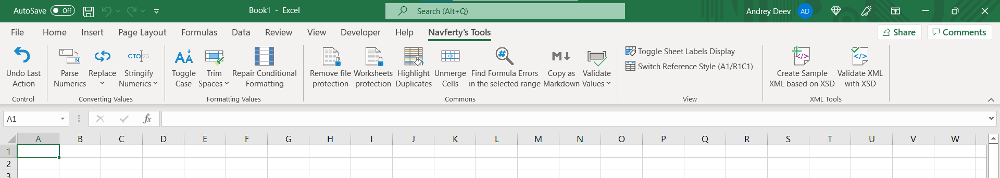
</section>
<section id="guides">
<h2>Guides for everyday Excel problems</h2>

Most of these start with the problem and show the built-in way to solve it. The add-in is mentioned where it saves some clicks.

<a class="card" href="/en/articles/find-all-errors-in-excel/"><strong>How to find all errors in Excel (#VALUE!, #REF!, #DIV/0!)</strong>Ways to locate every formula error in a sheet, and what each error usually means.</a>
<a class="card" href="/en/articles/text-numbers-to-numeric-values/"><strong>Converting text numbers to numeric values</strong>Why numbers become text in Excel and several ways to convert them back.</a>
<a class="card" href="/en/articles/remove-extra-spaces-in-excel/"><strong>Removing extra spaces in Excel</strong>TRIM, non-breaking spaces and line breaks: how to clean text cells properly.</a>
<a class="card" href="/en/articles/highlight-duplicate-values-in-excel/"><strong>Highlighting duplicate values without formulas</strong>Conditional formatting, Remove Duplicates and what to do when you need to see which rows match.</a>
<a class="card" href="/en/articles/vlookup-in-excel/"><strong>VLOOKUP in Excel: syntax, examples and common errors</strong>Syntax, a worked example with two sheets, the usual reasons for #N/A, and XLOOKUP or INDEX/MATCH as alternatives.</a>
<a class="card" href="/en/articles/excel-keyboard-shortcuts/"><strong>Excel keyboard shortcuts that save the most time</strong>Shortcuts for editing, moving, selecting, filling and pasting, grouped by task.</a>

<a href="/en/articles/">All guides →</a>

</section>
<section id="commands">
<h2>Commands</h2>

Everything on the Navferty's Tools ribbon tab. Open a command to see what it does with before/after screenshots.

<h3>Clean up text and numbers</h3>

<a class="cmd" href="/en/features/parse-numerics/">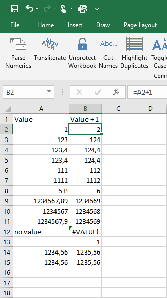<strong>Parse Numerics</strong>Turns numbers stored as text into real numbers.</a>
<a class="cmd" href="/en/features/trim-spaces/">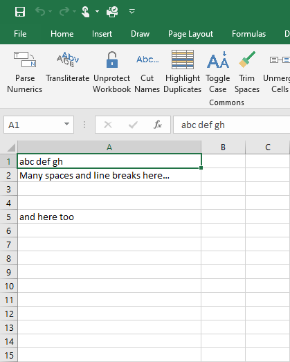<strong>Trim Spaces</strong>Removes extra spaces and line breaks from text cells.</a>
<a class="cmd" href="/en/features/toggle-case/">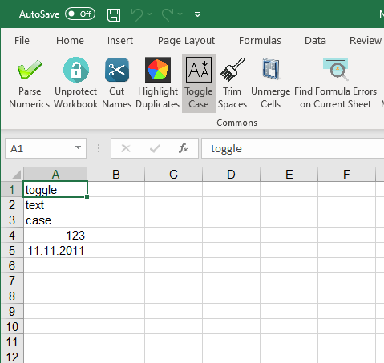<strong>Toggle Case</strong>Cycles text between Abc, abc and ABC.</a>
<a class="cmd" href="/en/features/unmerge-cells/">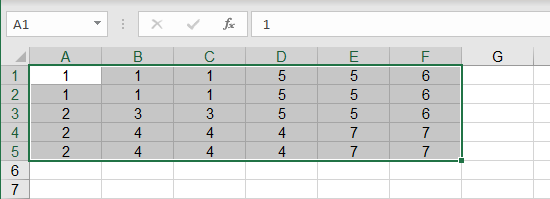<strong>Unmerge Cells</strong>Unmerges cells and fills each one with the original value.</a>
<a class="cmd" href="/en/features/repair-conditional-format/"><strong>Conditional Formatting</strong>Fills formatting across selected rows using a source row.</a>

<h3>Letters and number formats</h3>

<a class="cmd" href="/en/features/replace/">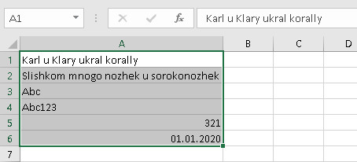<strong>Replace</strong>Transliterates Cyrillic or swaps look-alike letters for Latin ones.</a>
<a class="cmd" href="/en/features/stringify-numerics/">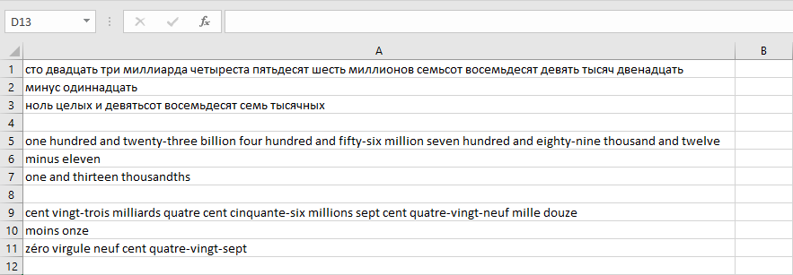<strong>Stringify Numerics</strong>Writes numbers in words in Russian, English or French.</a>

<h3>Find problems in data</h3>

<a class="cmd" href="/en/features/find-errors/">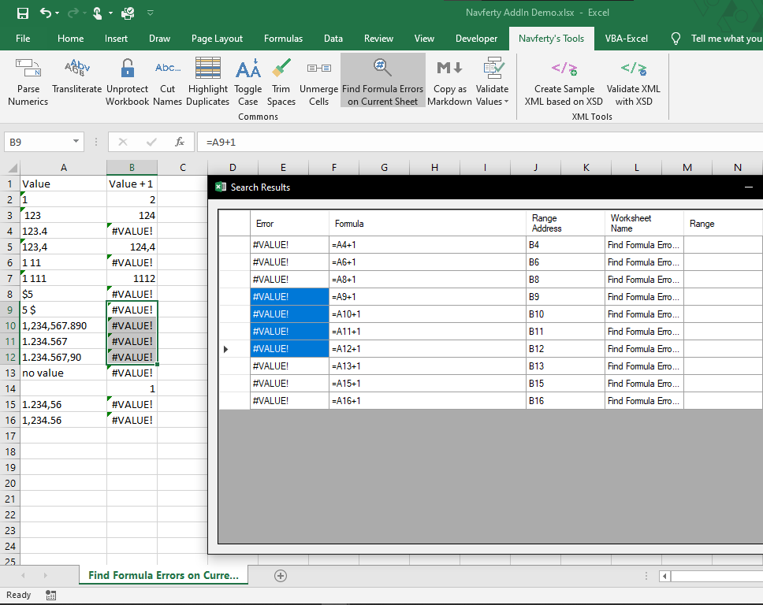<strong>Find All Cells Containing Errors</strong>Lists every formula error in the selection and jumps to it.</a>
<a class="cmd" href="/en/features/highlight-duplications/">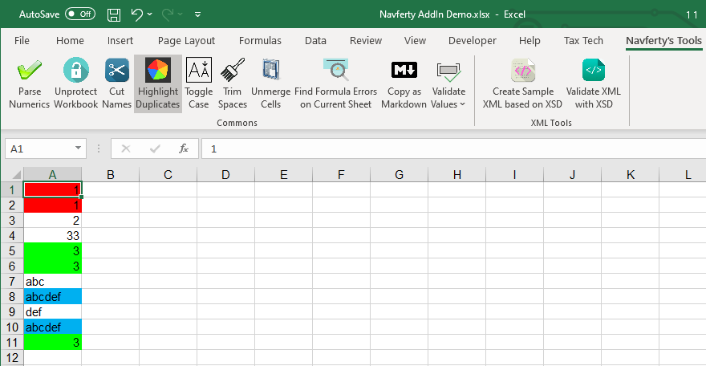<strong>Highlight Duplications</strong>Colours repeated values, one colour per group.</a>
<a class="cmd" href="/en/features/validate-values/">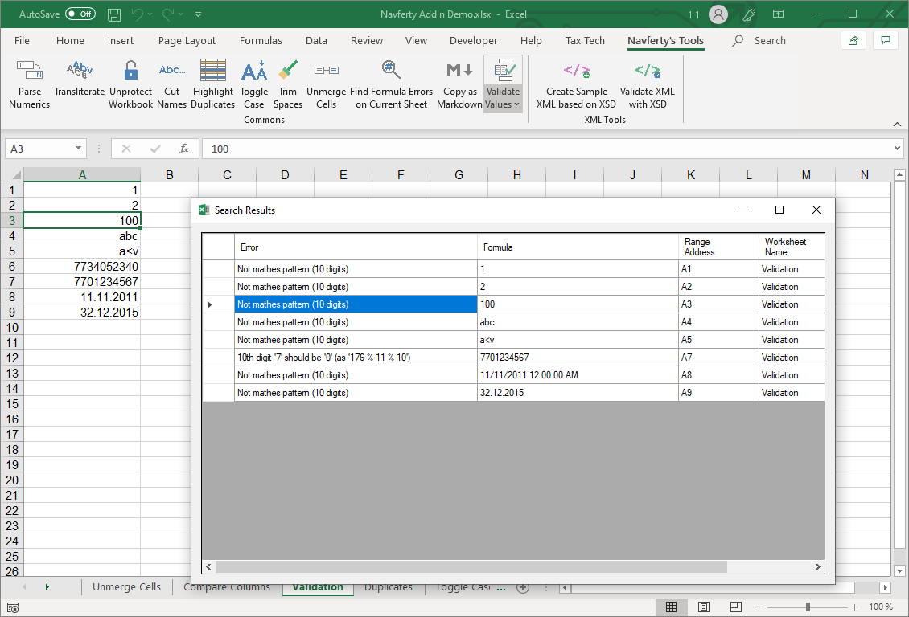<strong>Validate Values</strong>Checks values as numbers, dates, TIN or with an XML-text character filter.</a>

<h3>Export, XML and protection</h3>

<a class="cmd" href="/en/features/copy-as-markdown/">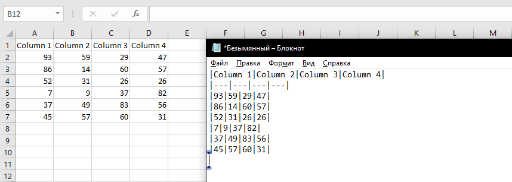<strong>Copy as Markdown</strong>Copies the selected cells as a Markdown table.</a>
<a class="cmd" href="/en/features/export-to-sqlite/">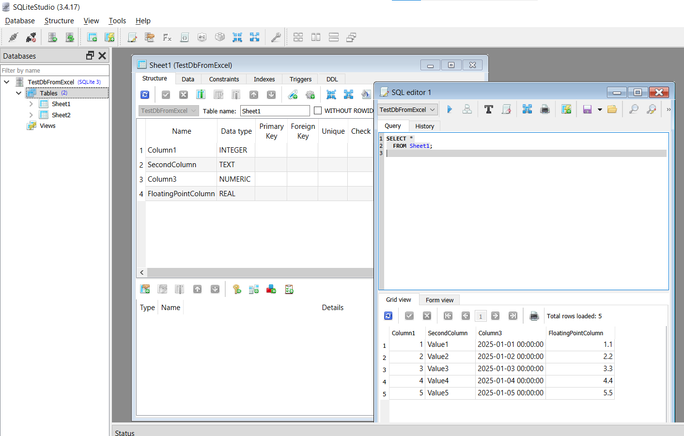<strong>Export to SQLite</strong>Exports worksheet data to a SQLite database.</a>
<a class="cmd" href="/en/features/create-sample-xml/"><strong>Create Sample XML based on XSD</strong>Builds a sample XML file from an XSD schema.</a>
<a class="cmd" href="/en/features/validate-xml/">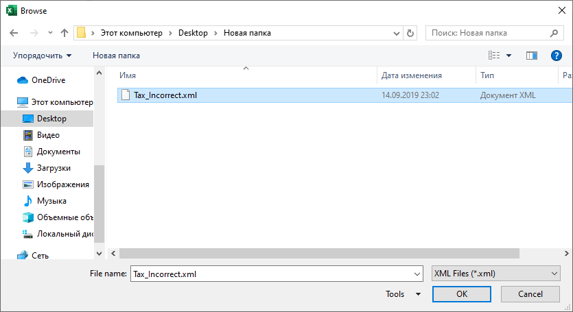<strong>Validate XML with XSD</strong>Checks an XML file against an XSD and reports errors in a sheet.</a>
<a class="cmd" href="/en/features/unprotect-workbook/"><strong>Unprotect Workbook</strong>Removes sheet and workbook-structure protection; attempts to unlock VBA.</a>
<a class="cmd" href="/en/features/worksheets-protection/"><strong>Worksheets Protection</strong>Protects or unprotects many worksheets at once.</a>
<a class="cmd" href="/en/features/undo-last-action/"><strong>Undo Last Action</strong>Reverts the most recent supported value transformation.</a>

<h3>More tools</h3>

<a class="cmd" href="/en/features/toggle-sheet-tabs/"><strong>Sheet Tabs</strong>Shows or hides the worksheet tabs.</a>
<a class="cmd" href="/en/features/switch-reference-style/"><strong>Reference Style (A1/R1C1)</strong>Switches formula references between A1 and R1C1 style.</a>
<a class="cmd" href="/en/features/exchange-rates/"><strong>Exchange rates</strong>Picks a currency rate from an online source and pastes it into the cell.</a>

</section>
<section id="install">
<h2>Installation</h2>

1

<h4>Download and unpack the installer archive</h4>
Get the latest version from our server:

<a class="btn btn-primary btn-small" href="https://deploy.navferty.net/setup.zip">Download setup.zip</a>

2

<h4>Run the installation</h4>
Double-click the downloaded <code>setup.exe</code> file and follow the installation wizard.

3

<h4>Restart Excel</h4>
If Excel was open during installation, restart it. You'll see the new <strong>Navferty's Tools</strong> tab in the ribbon.

<a href="/en/install/">Full instructions, certificate and offline install →</a>

</section>
<section id="support">
<h2>Support and feedback</h2>

Found a bug or need a new command? <a href="/en/support/#bug">Report a bug</a> or <a href="/en/support/#feature">request a feature</a> on GitHub, and see how to <a href="/en/support/#logs">find the logs</a> to attach.

<a href="/en/support/">Support and feedback →</a>

</section>
