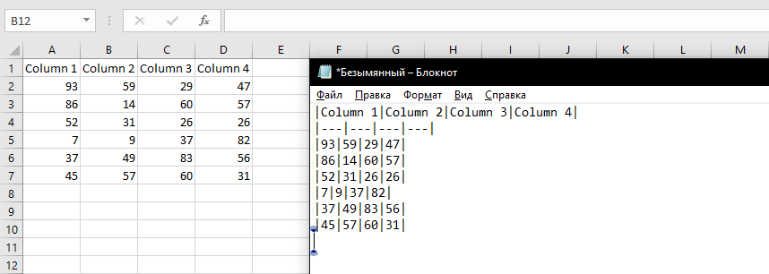

{
  "title": "Copy as Markdown",
  "description": "Copy selected cells to clipboard as a markdown-formatted table.",
  "image": "https://navferty.net/images/ExportToMarkdown.png"
}

[Home](/en/) › [Commands](/en/#commands) › Copy as Markdown

# Copy as Markdown

Copy selected cells to clipboard as a markdown-formatted table.

The add-in is free and open source. [Installation instructions](/en/install/).
