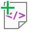

{
  "title": "Create Sample XML based on XSD",
  "description": "Generate a sample XML file from an XSD schema to visualize the structure.",
  "image": "https://navferty.net/images/CreateSampleXml1.png"
}

[Home](/en/) › [Commands](/en/#commands) › Create Sample XML based on XSD

# Create Sample XML based on XSD

Generate a sample XML file from an XSD schema to visualize the structure.

## View example

**Input XSD Schema:**

    <xsd:schema xmlns:xsd="http://www.w3.org/2001/XMLSchema"
               xmlns:tns="http://tempuri.org/PurchaseOrderSchema.xsd"
               targetNamespace="http://tempuri.org/PurchaseOrderSchema.xsd"
               elementFormDefault="qualified">
     <xsd:element name="PurchaseOrder" type="tns:PurchaseOrderType"/>
     <xsd:complexType name="PurchaseOrderType">
      <xsd:sequence>
       <xsd:element name="ShipTo" type="tns:USAddress" maxOccurs="2"/>
       <xsd:element name="BillTo" type="tns:USAddress"/>
      </xsd:sequence>
      <xsd:attribute name="OrderDate" type="xsd:date"/>
     </xsd:complexType>

     <xsd:complexType name="USAddress">
      <xsd:sequence>
       <xsd:element name="name"   type="xsd:string"/>
       <xsd:element name="street" type="xsd:string"/>
       <xsd:element name="city"   type="xsd:string"/>
       <xsd:element name="state"  type="xsd:string"/>
       <xsd:element name="zip"    type="xsd:integer"/>
      </xsd:sequence>
      <xsd:attribute name="country" type="xsd:NMTOKEN" fixed="US"/>
     </xsd:complexType>
    </xsd:schema>

**Generated XML Output:**

    <PurchaseOrder xmlns:xsi="http://www.w3.org/2001/XMLSchema-instance" OrderDate="1900-01-01" xmlns="http://tempuri.org/PurchaseOrderSchema.xsd">
      <ShipTo country="US">
        <name>name1</name>
        <street>street1</street>
        <city>city1</city>
        <state>state1</state>
        <zip>1</zip>
      </ShipTo>
      <ShipTo country="US">
        <name>name2</name>
        <street>street2</street>
        <city>city2</city>
        <state>state2</state>
        <zip>-79228162514264337593543950335</zip>
      </ShipTo>
      <BillTo country="US">
        <name>name1</name>
        <street>street1</street>
        <city>city1</city>
        <state>state1</state>
        <zip>1</zip>
      </BillTo>
    </PurchaseOrder>

**Related guide:** [Validating XML against XSD inside Excel](/en/articles/validate-xml-against-xsd-in-excel/)

## How to use

Click **XML from XSD**, select an XSD schema, then choose a new XML output filename. The add-in writes an indented UTF-8 sample file; open it in a text or XML editor to inspect the generated elements and attributes.

For example, a purchase-order schema can produce a sample with `PurchaseOrder` and `ShipTo` elements, as shown above. The sample illustrates the schema structure, not real order data.

Choose a filename that does not already exist. Review generated values and validate the sample against the intended schema before using it as a template for an integration.

The add-in is free and open source. [Installation instructions](/en/install/).
