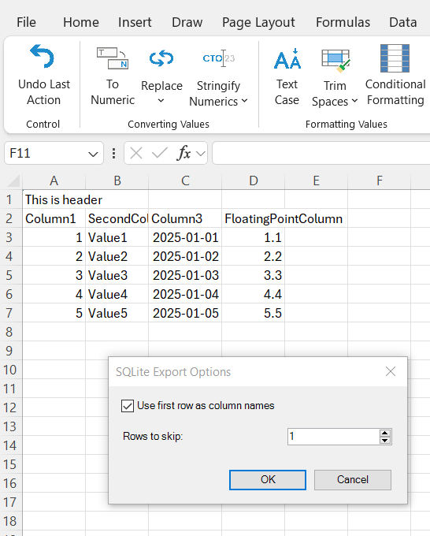
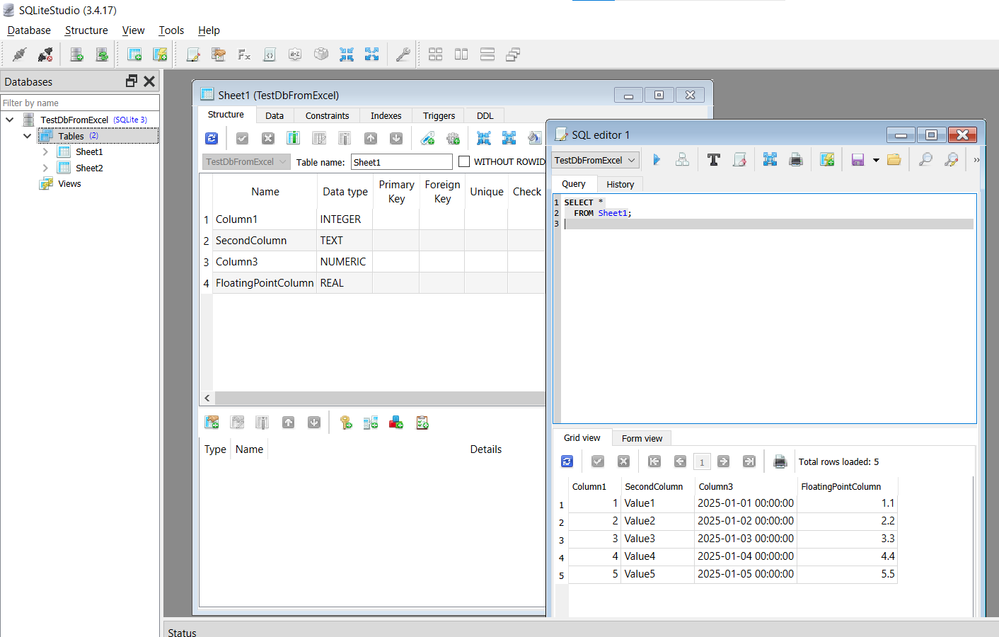

{
  "title": "Export to SQLite",
  "description": "Export the entire workbook to a SQLite database file. Each worksheet becomes a separate table with automatic column type detection.",
  "image": "https://navferty.net/images/ExportToSqlite1.png"
}

[Home](/en/) › [Commands](/en/#commands) › Export to SQLite

# Export to SQLite

Export the entire workbook to a SQLite database file. Each worksheet becomes a separate table with automatic column type detection.

- Use first row as column headers
- Skip initial rows if needed
- Automatic data type detection

 

**Related guide:** [Exporting Excel data to SQLite](/en/articles/export-excel-data-to-sqlite/)

The add-in is free and open source. [Installation instructions](/en/install/).
