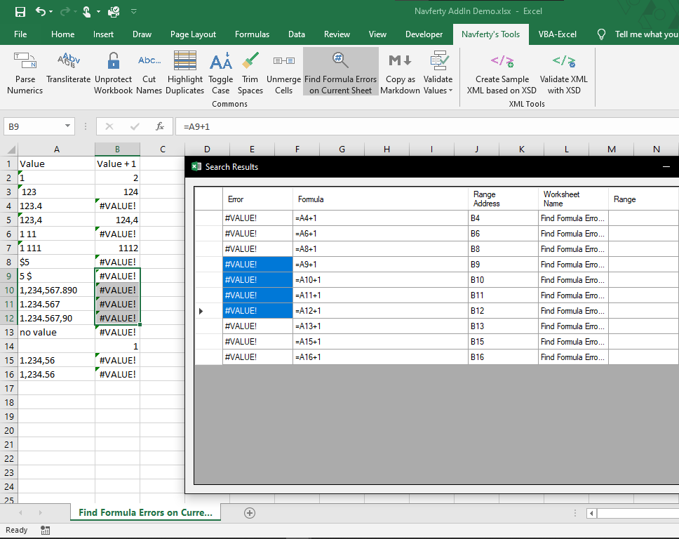

{
  "title": "Find All Cells Containing Errors",
  "description": "Locate all formula errors in the selected range",
  "image": "https://navferty.net/images/FindErrorValues.png"
}

[Home](/en/) › [Commands](/en/#commands) › Find All Cells Containing Errors

# Find All Cells Containing Errors

Locate all formula errors in the selected range:

`#N/A` `#NAME?` `#DIV/0!` `#REF!` `#VALUE!` `#NUM!` `#NULL!`

Clicking the entry in the search results will navigate to the corresponding cell in the worksheet.

**Related guide:** [How to find all errors in Excel (#VALUE!, \#REF!, \#DIV/0!)](/en/articles/find-all-errors-in-excel/)

## How to use

Select a range and click **Find Errors**. The results window lists each error, its formula or value, address and worksheet. Select a result to select its cell in Excel.

For example, if `B2` contains `=1/0`, the report includes a division-by-zero error at `B2`. If a single cell is selected, the command searches the active worksheet's used range instead; selecting the entire sheet also uses its used range. If no errors are found, a message is shown.

This identifies Excel error values, not every incorrect formula or unexpected result. It does not correct the errors.

The add-in is free and open source. [Installation instructions](/en/install/).
