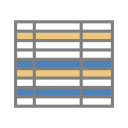
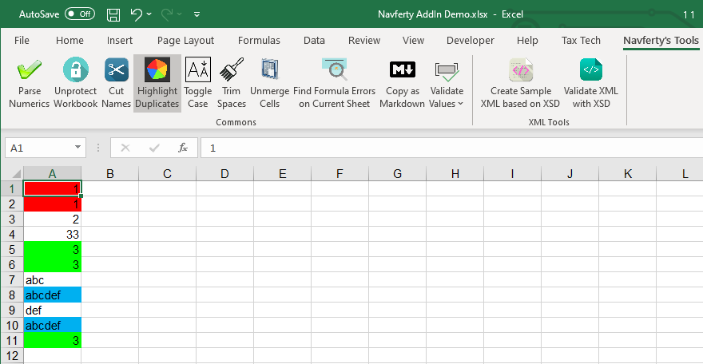

{
  "title": "Highlight Duplications",
  "description": "Automatically color-code duplicate values in the selected range. Different colors indicate different duplicate groups.",
  "image": "https://navferty.net/images/Duplicates.png"
}

[Home](/en/) › [Commands](/en/#commands) › Highlight Duplications

# Highlight Duplications

Automatically color-code duplicate values in the selected range. Different colors indicate different duplicate groups.

**Related guide:** [Highlighting duplicate values without formulas](/en/articles/highlight-duplicate-values-in-excel/)

The add-in is free and open source. [Installation instructions](/en/install/).
