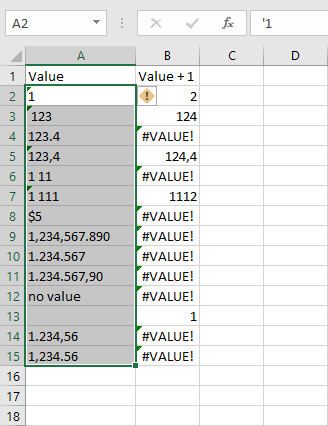
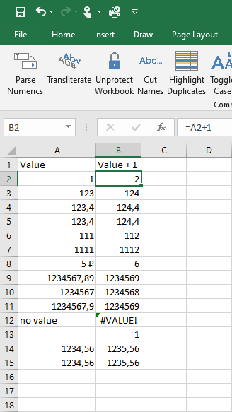

{
  "title": "Parse Numerics",
  "description": "Convert numbers stored as text to proper numeric format, making them usable in calculations.",
  "image": "https://navferty.net/images/ParseNumerics1.png"
}

[Home](/en/) › [Commands](/en/#commands) › Parse Numerics

# Parse Numerics

Convert numbers stored as text to proper numeric format, making them usable in calculations.

 

**Related guide:** [Converting text numbers to numeric values](/en/articles/text-numbers-to-numeric-values/)

## How to use

Select the cells and choose **To Numeric** on the Navferty's Tools ribbon. Text that can be parsed as a number is replaced with an Excel number; unrecognized text is left unchanged.

For example, a text value `123` becomes the number `123`, so a formula such as `=A1+1` can calculate with it. Check the result for imported numbers that use different decimal or thousands separators.

**Important:** Save a copy first and avoid selecting formulas: this command writes values back to the selected area and can replace formulas with their results. Leading zeroes in identifiers such as `00123` are not preserved as numeric values.

The add-in is free and open source. [Installation instructions](/en/install/).
