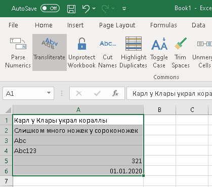
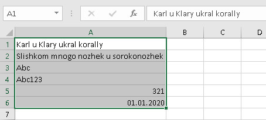
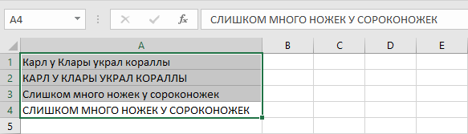
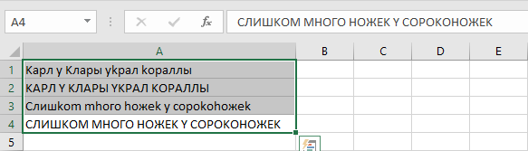

{
  "title": "Replace",
  "description": "Replace Cyrillic characters using different transformation methods.",
  "image": "https://navferty.net/images/Transliterate1.png"
}

[Home](/en/) › [Commands](/en/#commands) › Replace

# Replace

Replace Cyrillic characters using different transformation methods.

##  With Transliteration

Complete transliteration of Cyrillic alphabet to English. For example: "Ж" → "Zh", "Щ" → "Shch". Based on ICAO Doc <a href="https://www.icao.int/sites/default/files/publications/DocSeries/9303_p3_cons_en.pdf" rel="noopener" target="_blank">9303</a>.

 

##  Replace Chars

Replace visually similar Cyrillic letters with Latin letters: А→A, В→B, Е→E, К→K, М→M, Н→H, О→O, Р→P, С→C, Т→T, У→Y, Х→X.

 

## How to use

Select the text cells and choose an option from **Replace**. **With Transliteration** converts Russian Cyrillic letters according to the displayed mapping; for example, `Жук` becomes `Zhuk`. **Replace Chars** changes only look-alike Cyrillic characters to Latin: `СОС` becomes `COC`. It does not convert Latin letters back to Cyrillic.

**Important:** Transliteration is not translation, and characters outside the supported mapping may not be retained. Review names against the required standard. The command writes values back to the selection and can replace formulas with their results; save a copy first.

The add-in is free and open source. [Installation instructions](/en/install/).
