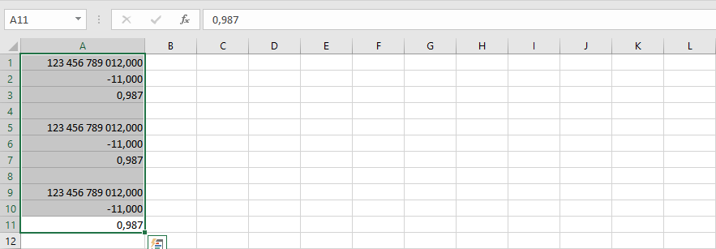
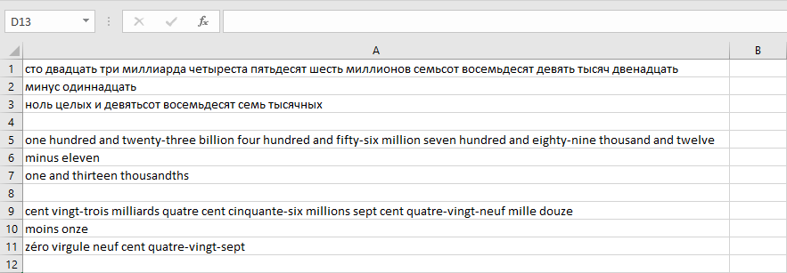

{
  "title": "Stringify Numerics",
  "description": "Convert numbers to their word representation in multiple languages",
  "image": "https://navferty.net/images/Stringify1.png"
}

[Home](/en/) › [Commands](/en/#commands) › Stringify Numerics

# Stringify Numerics

Convert numbers to their word representation in multiple languages:

- Russian
- English
- French

 

## How to use

Select numeric cells and choose Russian, English or French from the **Stringify Numerics** menu. The main button uses Russian; use the menu to choose another language. For example, selecting English for `11` produces `eleven`.

**Important:** This replaces numbers with text in the selected cells, so they can no longer be used as numbers in calculations. Text that merely looks numeric is not converted; use [To Numeric](/en/features/parse-numerics/) first if appropriate. Formulas in the selected area can also be replaced with their results, so work on a copy.

The add-in is free and open source. [Installation instructions](/en/install/).
