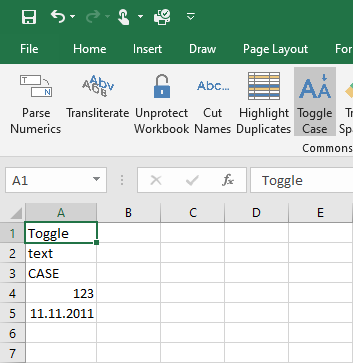
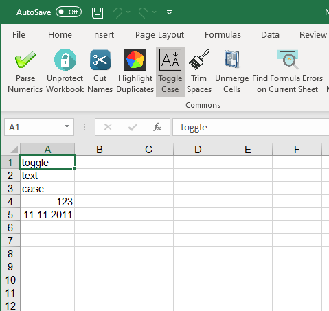
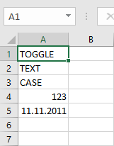
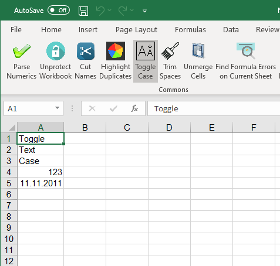

{
  "title": "Toggle Case",
  "description": "Cycle through text case transformations: Abcde → abcde → ABCDE",
  "image": "https://navferty.net/images/ToggleCase1.png"
}

[Home](/en/) › [Commands](/en/#commands) › Toggle Case

# Toggle Case

Cycle through text case transformations: `Abcde` → `abcde` → `ABCDE`

   

The add-in is free and open source. [Installation instructions](/en/install/).
