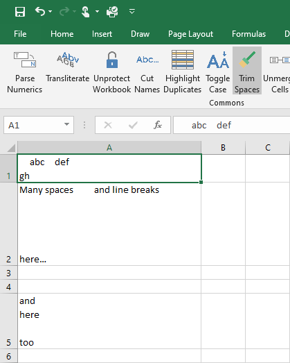
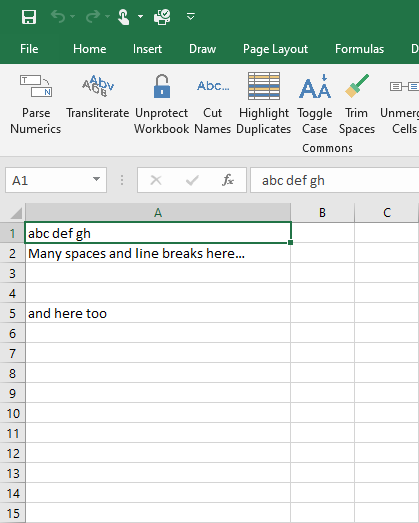

{
  "title": "Trim Spaces",
  "description": "Remove extra spaces, line breaks, and leading/trailing whitespace from text cells.",
  "image": "https://navferty.net/images/TrimSpaces1.png"
}

[Home](/en/) › [Commands](/en/#commands) › Trim Spaces

# Trim Spaces

Remove extra spaces, line breaks, and leading/trailing whitespace from text cells.

 

**Related guide:** [Removing extra spaces in Excel](/en/articles/remove-extra-spaces-in-excel/)

## How to use

Select text cells and choose **Trim Spaces**. The default action replaces runs of whitespace, including line breaks, with one space and removes whitespace at the ends. For example, `  New   York  ` becomes `New York`.

Open the button's menu for **Remove All Spaces**, which removes whitespace between words too: `New York` becomes `NewYork`. Cells containing only whitespace become empty. Non-text values are not transformed.

**Important:** These actions write values back to the selected area and can replace formulas with their results. Save a copy or select only the text cells to change.

The add-in is free and open source. [Installation instructions](/en/install/).
