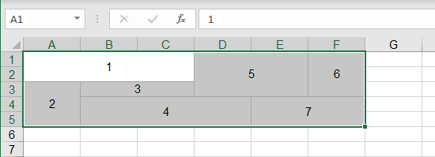
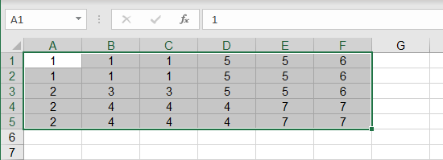

{
  "title": "Unmerge Cells",
  "description": "Unmerge cells while filling each cell with the original merged value.",
  "image": "https://navferty.net/images/Unmerge1.png"
}

[Home](/en/) › [Commands](/en/#commands) › Unmerge Cells

# Unmerge Cells

Unmerge cells while filling each cell with the original merged value.

 

The add-in is free and open source. [Installation instructions](/en/install/).
