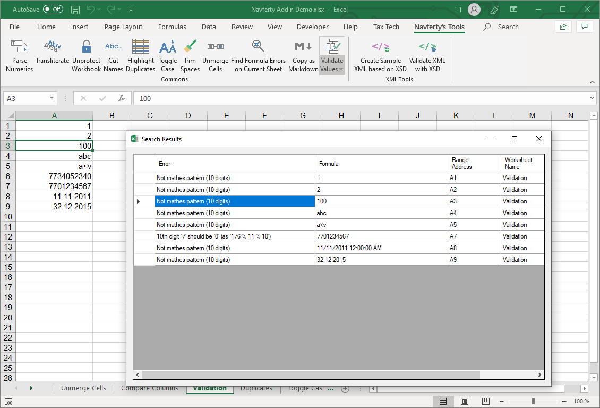

{
  "title": "Validate Values",
  "description": "Check cell values against specific formats",
  "image": "https://navferty.net/images/Validate.png"
}

[Home](/en/) › [Commands](/en/#commands) › Validate Values

# Validate Values

Check cell values against specific formats:

- Number
- Date
- TIN of an individual (12 digits, with verification digits)
- TIN of a legal entity (10 digits, with verification digit)
- Text checked against the add-in's XML-text character filter

*Note: Valid TIN format doesn't guarantee the organization or individual exists.*

## How to use

Select cells, open the **Validate** menu and choose a check. The results window lists failed values, their addresses and messages; selecting a result selects the corresponding cell. Empty cells are skipped, and validation does not change cell values.

For example, choose the organization TIN check for a column of Russian 10-digit identifiers: a value with an incorrect check digit appears in the report. The personal TIN check uses 12 digits and two check digits. Store identifiers as text when leading zeroes matter.

**Important:** The XML-text check is a restrictive character filter, not an XML parser or an XSD validation. It rejects characters including `<`, `>`, `&`, quotes and control characters, and also excludes additional character ranges. Use [Validate XML with XSD](/en/features/validate-xml/) for a complete XML file. Number and date checks use the validator's parsing rules, which may differ from the display format in Excel. The numeric check is not a substitute for [Find Errors](/en/features/find-errors/).

The add-in is free and open source. [Installation instructions](/en/install/).
