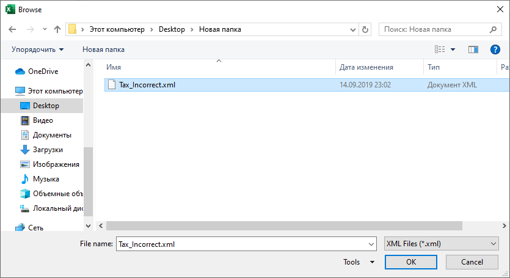

{
  "title": "Validate XML with XSD",
  "description": "Validate an XML file against an XSD schema. A detailed error report will be created in a new workbook.",
  "image": "https://navferty.net/images/ValidateXml1.png"
}

[Home](/en/) › [Commands](/en/#commands) › Validate XML with XSD

# Validate XML with XSD

Validate an XML file against an XSD schema. A detailed error report will be created in a new workbook.

## View sample error report

| Severity | Element  | Message                                                                                                                                    |
|----------|----------|--------------------------------------------------------------------------------------------------------------------------------------------|
| Error    | city     | The element 'shipto' has invalid child element 'city'. List of possible elements expected: 'address'.                                      |
| Error    | quantity | The 'quantity' element is invalid - The value '-5' is invalid according to its datatype 'http://www.w3.org/2001/XMLSchema:positiveInteger' |
| Error    | price    | The 'price' element is invalid - The value 'asdasd' is invalid according to its datatype 'http://www.w3.org/2001/XMLSchema:decimal'        |

**Related guide:** [Validating XML against XSD inside Excel](/en/articles/validate-xml-against-xsd-in-excel/)

The add-in is free and open source. [Installation instructions](/en/install/).
