{
  "title": "Надстройка Navferty Excel Add-In",
  "description": "Бесплатная надстройка Excel с открытым кодом: очистка текста, преобразование чисел, поиск ошибок и дубликатов, проверка значений и XML, экспорт в SQLite.",
  "image": "https://navferty.net/images/NavfertyToolsRibbonRu.png"
}

<section class="hero">
<h1 class="zag">Надстройка Navferty Excel Add-In</h1>

Бесплатная надстройка для Excel: инструменты для обработки данных, форматирования и валидации.

<ul class="facts"><li>Бесплатно</li><li>Открытый код (MIT)</li><li>Для настольного Excel в Windows</li></ul>

<a class="btn btn-primary" href="https://deploy.navferty.net/setup.zip"><svg aria-hidden="true" fill="none" height="20" role="img" viewbox="0 0 20 20" width="20" xmlns="http://www.w3.org/2000/svg"><path d="M10 13L5 8h3V3h4v5h3l-5 5z" fill="currentColor"></path><path d="M3 15h14v2H3v-2z" fill="currentColor"></path></svg>Скачать установщик</a>
<a class="btn btn-secondary" href="#commands">Смотреть команды</a>

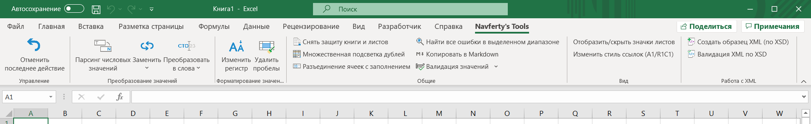
</section>
<section id="guides">
<h2>Статьи о повседневных проблемах в Excel</h2>

Большинство статей начинается с проблемы и показывает, как решить её встроенными средствами. Надстройка упоминается там, где она экономит несколько кликов.

<a class="card" href="/ru/articles/find-all-errors-in-excel/"><strong>Как найти все ошибки в Excel (#ЗНАЧ!, #ССЫЛКА!, #ДЕЛ/0!)</strong>Способы найти все ошибки в формулах на листе и что означает каждая из них.</a>
<a class="card" href="/ru/articles/text-numbers-to-numeric-values/"><strong>Преобразование чисел-как-текст в числа</strong>Почему числа в Excel становятся текстом и несколько способов вернуть им числовой тип.</a>
<a class="card" href="/ru/articles/remove-extra-spaces-in-excel/"><strong>Как убрать лишние пробелы в Excel</strong>СЖПРОБЕЛЫ, неразрывные пробелы и переносы строк: как правильно очистить текстовые ячейки.</a>
<a class="card" href="/ru/articles/highlight-duplicate-values-in-excel/"><strong>Подсветка дубликатов в Excel без формул</strong>Условное форматирование, удаление дубликатов и что делать, если нужно видеть, какие строки совпадают.</a>
<a class="card" href="/ru/articles/vlookup-in-excel/"><strong>ВПР (VLOOKUP) в Excel: синтаксис, примеры и частые ошибки</strong>Синтаксис, пример с двумя листами, типичные причины #Н/Д и альтернативы: ПРОСМОТРX и ИНДЕКС/ПОИСКПОЗ.</a>
<a class="card" href="/ru/articles/excel-keyboard-shortcuts/"><strong>Горячие клавиши Excel, которые экономят больше всего времени</strong>Сочетания клавиш для редактирования, перемещения, выделения, заполнения и вставки, сгруппированные по задачам.</a>

<a href="/ru/articles/">Все статьи →</a>

</section>
<section id="commands">
<h2>Команды</h2>

Всё, что есть на вкладке Navferty's Tools. Откройте команду, чтобы увидеть, что она делает, на скриншотах «до» и «после».

<h3>Очистка текста и чисел</h3>

<a class="cmd" href="/ru/features/parse-numerics/">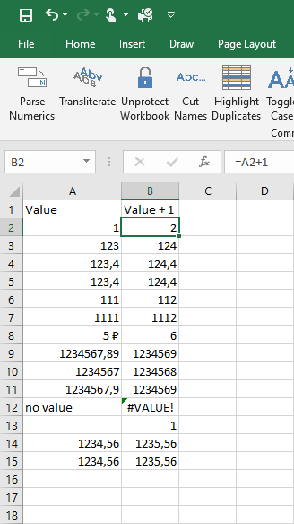<strong>Парсинг чисел</strong>Превращает числа, сохранённые как текст, в настоящие числа.</a>
<a class="cmd" href="/ru/features/trim-spaces/">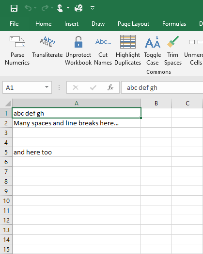<strong>Удалить пробелы</strong>Убирает лишние пробелы и переносы строк в текстовых ячейках.</a>
<a class="cmd" href="/ru/features/toggle-case/">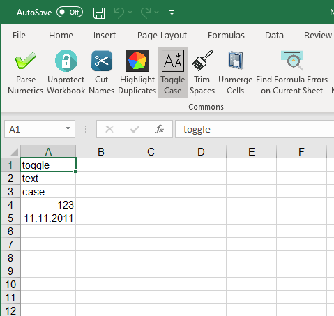<strong>Изменить регистр</strong>Переключает регистр: Абв, абв, АБВ.</a>
<a class="cmd" href="/ru/features/unmerge-cells/">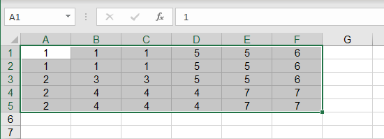<strong>Разъединить ячейки</strong>Разъединяет ячейки и заполняет каждую исходным значением.</a>
<a class="cmd" href="/ru/features/repair-conditional-format/"><strong>Условное форматирование</strong>Распространяет форматирование на выделенные строки по образцу.</a>

<h3>Буквы и форматы чисел</h3>

<a class="cmd" href="/ru/features/replace/">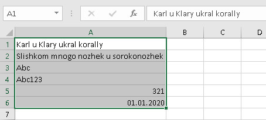<strong>Заменить</strong>Транслитерация или замена русских букв на похожие латинские.</a>
<a class="cmd" href="/ru/features/stringify-numerics/">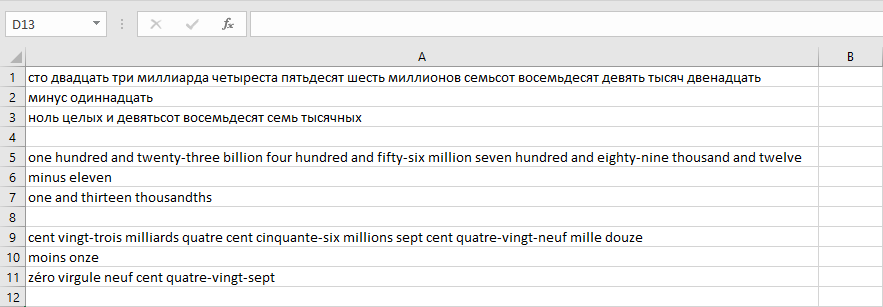<strong>Преобразовать числа в слова</strong>Записывает числа словами по-русски, по-английски или по-французски.</a>

<h3>Поиск проблем в данных</h3>

<a class="cmd" href="/ru/features/find-errors/">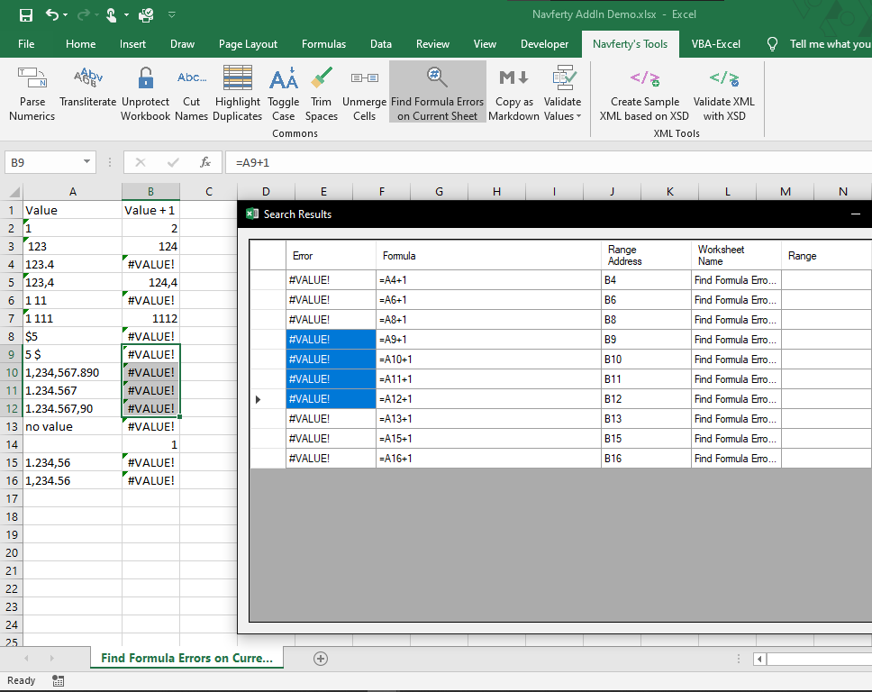<strong>Найти все ошибки в выделенном диапазоне</strong>Показывает список всех ошибок формул и переходит к ячейке.</a>
<a class="cmd" href="/ru/features/highlight-duplications/">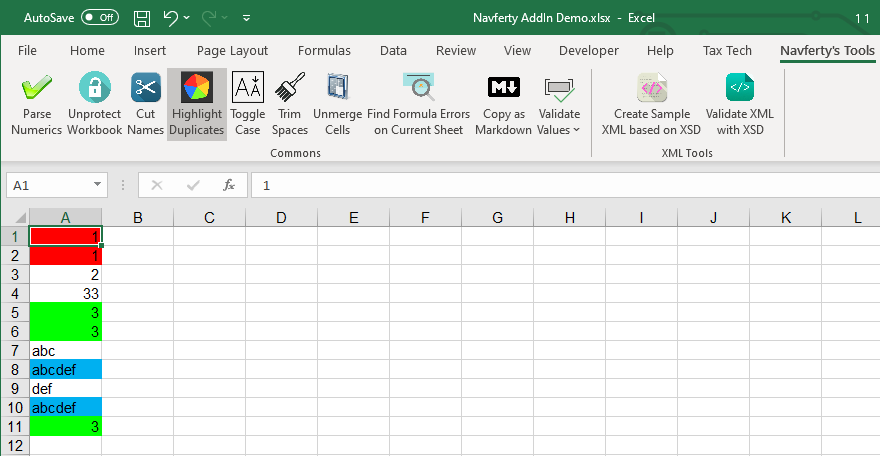<strong>Подсветить дубликаты</strong>Окрашивает повторяющиеся значения, каждой группе свой цвет.</a>
<a class="cmd" href="/ru/features/validate-values/">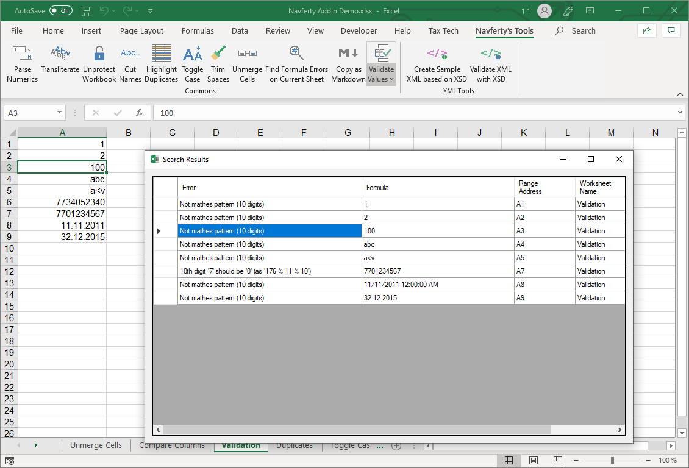<strong>Валидация значений</strong>Проверяет значения: число, дата, ИНН, текст для XML.</a>

<h3>Экспорт, XML и защита</h3>

<a class="cmd" href="/ru/features/copy-as-markdown/">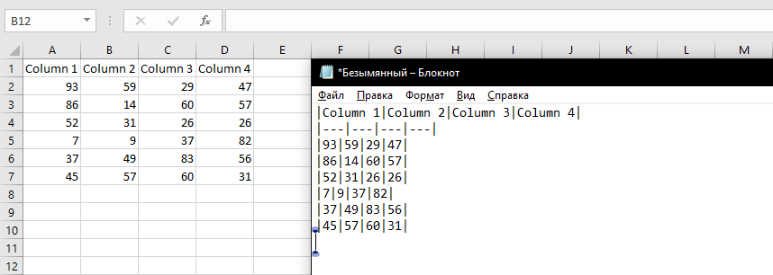<strong>Копировать в Markdown</strong>Копирует выделенные ячейки в виде Markdown-таблицы.</a>
<a class="cmd" href="/ru/features/export-to-sqlite/">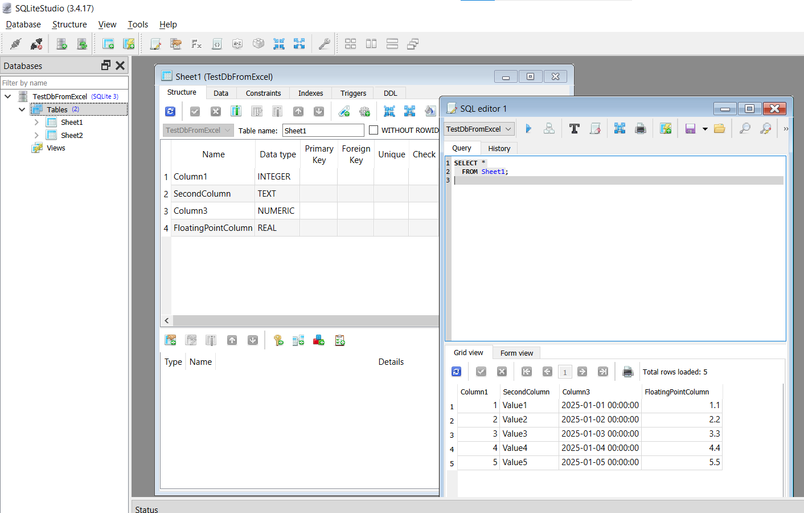<strong>Экспорт в SQLite</strong>Экспортирует данные листов в базу данных SQLite.</a>
<a class="cmd" href="/ru/features/create-sample-xml/"><strong>Создать образец XML по XSD</strong>Создаёт образец XML по XSD-схеме.</a>
<a class="cmd" href="/ru/features/validate-xml/">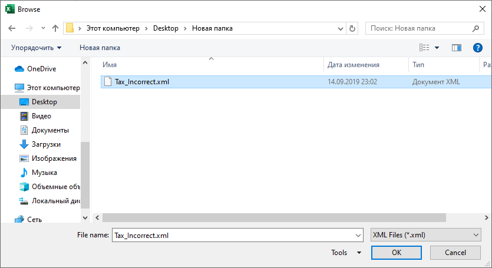<strong>Валидация XML по XSD</strong>Проверяет XML по XSD и выводит ошибки на лист.</a>
<a class="cmd" href="/ru/features/unprotect-workbook/"><strong>Снять защиту с книги</strong>Снимает защиту листов и структуры, пытается разблокировать VBA.</a>
<a class="cmd" href="/ru/features/worksheets-protection/"><strong>Защита листов</strong>Устанавливает или снимает защиту сразу с нескольких листов.</a>
<a class="cmd" href="/ru/features/undo-last-action/"><strong>Отменить последнее действие</strong>Отменяет последнее поддерживаемое преобразование значений.</a>

<h3>Прочие инструменты</h3>

<a class="cmd" href="/ru/features/toggle-sheet-tabs/"><strong>Ярлычки листов</strong>Показывает или скрывает ярлычки листов.</a>
<a class="cmd" href="/ru/features/switch-reference-style/"><strong>Стиль ссылок (A1/R1C1)</strong>Переключает ссылки в формулах между стилями A1 и R1C1.</a>
<a class="cmd" href="/ru/features/exchange-rates/"><strong>Курсы валют</strong>Выбирает курс валюты из интернет-источника и вставляет в ячейку.</a>

</section>
<section id="install">
<h2>Установка</h2>

1

<h4>Скачайте и разархивируйте архив с установщиком</h4>
Получите последнюю версию с нашего сервера:

<a class="btn btn-primary btn-small" href="https://deploy.navferty.net/setup.zip">Скачать setup.zip</a>

2

<h4>Запустите установку</h4>
Дважды щёлкните по загруженному файлу <code>setup.exe</code> и следуйте инструкциям мастера установки.

3

<h4>Перезапустите Excel</h4>
Если Excel был открыт во время установки, перезапустите его. Вы увидите новую вкладку <strong>Navferty's Tools</strong> на ленте.

<a href="/ru/install/">Подробная инструкция, сертификат и офлайн-установка →</a>

</section>
<section id="support">
<h2>Поддержка и обратная связь</h2>

Нашли ошибку или нужна новая команда? <a href="/ru/support/#bug">Сообщите об ошибке</a> или <a href="/ru/support/#feature">предложите функцию</a> на GitHub, и узнайте, <a href="/ru/support/#logs">где найти журналы</a> для вложения.

<a href="/ru/support/">Поддержка и обратная связь →</a>

</section>
