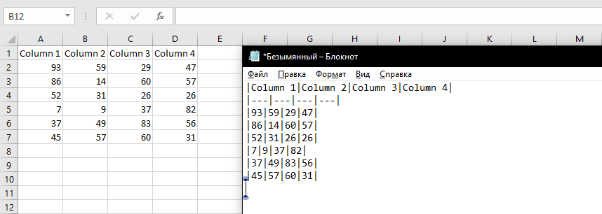

{
  "title": "Копировать в Markdown",
  "description": "Копирование выбранных ячеек в буфер обмена в формате markdown-таблицы.",
  "image": "https://navferty.net/images/ExportToMarkdown.png"
}

[Главная](/ru/) › [Команды](/ru/#commands) › Копировать в Markdown

# Копировать в Markdown

Копирование выбранных ячеек в буфер обмена в формате markdown-таблицы.

Надстройка бесплатная, с открытым кодом. [Инструкция по установке](/ru/install/).
