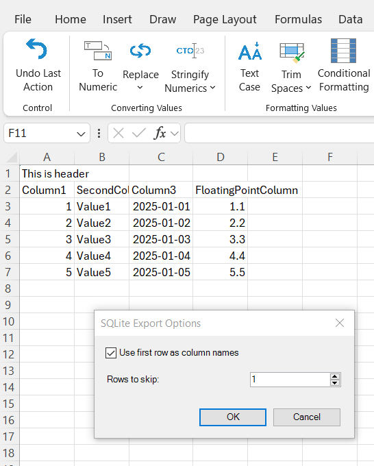
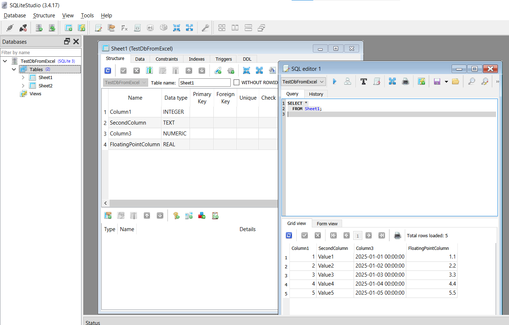

{
  "title": "Экспорт в SQLite",
  "description": "Экспорт всей книги в файл базы данных SQLite. Каждый лист становится отдельной таблицей с автоматическим определением типов столбцов.",
  "image": "https://navferty.net/images/ExportToSqlite1.png"
}

[Главная](/ru/) › [Команды](/ru/#commands) › Экспорт в SQLite

# Экспорт в SQLite

Экспорт всей книги в файл базы данных SQLite. Каждый лист становится отдельной таблицей с автоматическим определением типов столбцов.

- Использовать первую строку как заголовки столбцов
- Пропускать начальные строки при необходимости
- Автоматическое определение типов данных

 

**Статья по теме:** [Экспорт данных из Excel в SQLite](/ru/articles/export-excel-data-to-sqlite/)

Надстройка бесплатная, с открытым кодом. [Инструкция по установке](/ru/install/).
