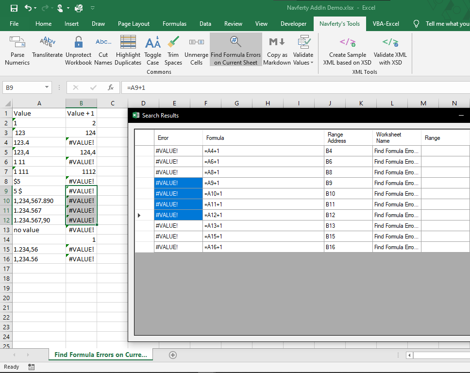

{
  "title": "Найти все ошибки в выделенном диапазоне",
  "description": "Поиск всех ошибок формул в выбранном диапазоне",
  "image": "https://navferty.net/images/FindErrorValues.png"
}

[Главная](/ru/) › [Команды](/ru/#commands) › Найти все ошибки в выделенном диапазоне

# Найти все ошибки в выделенном диапазоне

Поиск всех ошибок формул в выбранном диапазоне:

`#Н/Д` `#ИМЯ?` `#ДЕЛ/0!` `#ССЫЛКА!` `#ЗНАЧ!` `#ЧИСЛО!` `#ПУСТО!`

По клику на элемент в результатах поиска соответствующая ячейка будет выделена в рабочем листе.

**Статья по теме:** [Как найти все ошибки в Excel (#ЗНАЧ!, \#ССЫЛКА!, \#ДЕЛ/0!)](/ru/articles/find-all-errors-in-excel/)

## Как использовать

Выделите диапазон и нажмите **Найти ошибки**. Окно результатов показывает ошибку, формулу или значение, адрес и лист. Выберите строку результата, чтобы выделить соответствующую ячейку в Excel.

Например, если `B2` содержит `=1/0`, в отчёте появится ошибка деления на ноль с адресом `B2`. При выделении одной ячейки команда проверяет занятый диапазон активного листа; при выделении всего листа также используется занятый диапазон. Если ошибок нет, появится сообщение.

Команда находит значения ошибок Excel, но не все неправильные формулы или неожиданные результаты, и не исправляет ошибки автоматически.

Надстройка бесплатная, с открытым кодом. [Инструкция по установке](/ru/install/).
