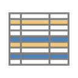
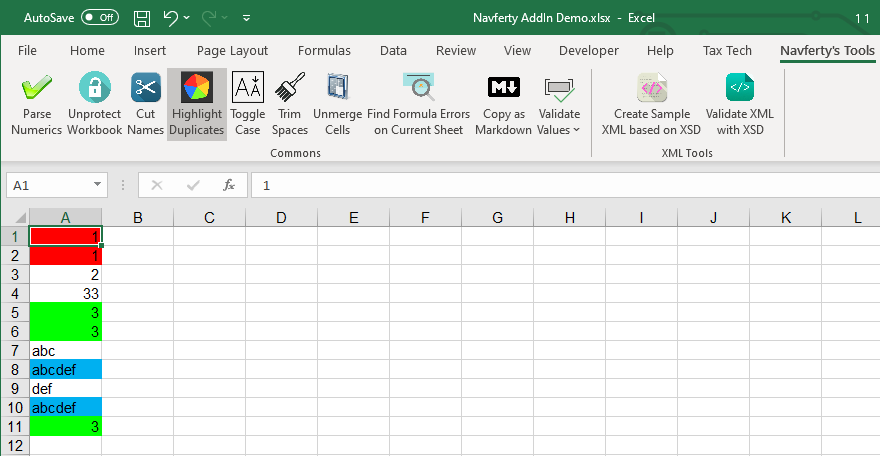

{
  "title": "Подсветить дубликаты",
  "description": "Автоматическая цветовая кодировка повторяющихся значений в выбранном диапазоне. Разные цвета обозначают разные группы дубликатов.",
  "image": "https://navferty.net/images/Duplicates.png"
}

[Главная](/ru/) › [Команды](/ru/#commands) › Подсветить дубликаты

# Подсветить дубликаты

Автоматическая цветовая кодировка повторяющихся значений в выбранном диапазоне. Разные цвета обозначают разные группы дубликатов.

**Статья по теме:** [Подсветка дубликатов в Excel без формул](/ru/articles/highlight-duplicate-values-in-excel/)

## Как использовать

Выделите ячейки для сравнения и нажмите **Раскрасить дубли**. Например, в последовательности `яблоко`, `груша`, `яблоко` обе ячейки со значением `яблоко` получат одинаковую заливку; другая группа повторов получит другой цвет.

Регистр букв не учитывается, пустые ячейки и значения только из пробельных символов пропускаются. Сравниваются отдельные значения во всём выделении, а не целые строки. Палитра ограничена, поэтому при большом числе групп цвета могут повторяться.

**Важно:** Существующая заливка ячеек с повторами изменится. Это разовая операция, а не автоматически обновляемое правило; после изменения данных повторите проверку и проверьте цвета.

Надстройка бесплатная, с открытым кодом. [Инструкция по установке](/ru/install/).
