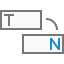
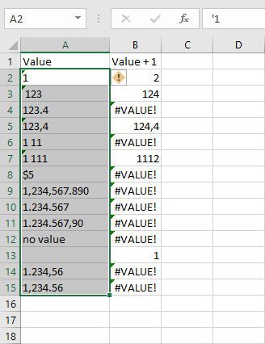
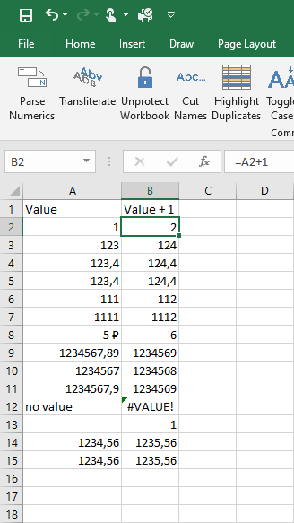

{
  "title": "Парсинг чисел",
  "description": "Преобразование чисел, сохранённых как текст, в правильный числовой формат для использования в вычислениях.",
  "image": "https://navferty.net/images/ParseNumerics1.png"
}

[Главная](/ru/) › [Команды](/ru/#commands) › Парсинг чисел

# Парсинг чисел

Преобразование чисел, сохранённых как текст, в правильный числовой формат для использования в вычислениях.

 

**Статья по теме:** [Преобразование чисел-как-текст в числа](/ru/articles/text-numbers-to-numeric-values/)

Надстройка бесплатная, с открытым кодом. [Инструкция по установке](/ru/install/).
