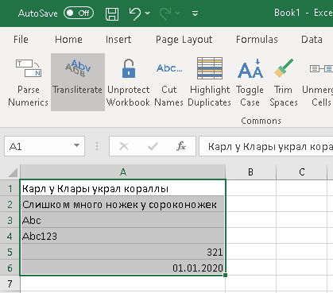
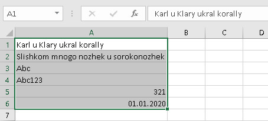
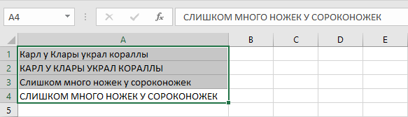
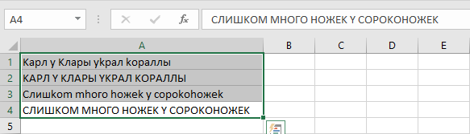

{
  "title": "Заменить",
  "description": "Замена русских символов различными методами преобразования.",
  "image": "https://navferty.net/images/Transliterate1.png"
}

[Главная](/ru/) › [Команды](/ru/#commands) › Заменить

# Заменить

Замена русских символов различными методами преобразования.

##  Транслитерацией

Полная транслитерация русского алфавита на английский. Например: "Ж" → "Zh", "Щ" → "Shch". Основано на документе ИКАО <a href="https://www.icao.int/sites/default/files/publications/DocSeries/9303_p3_cons_ru.pdf" rel="noopener" target="_blank">Doc 9303</a>.

 

##  На аналоги

Замена визуально схожих кириллических букв латинскими: А→A, В→B, Е→E, К→K, М→M, Н→H, О→O, Р→P, С→C, Т→T, У→Y, Х→X.

 

## Как использовать

Выделите текст и выберите вариант в меню **Замена**. **Транслитерация** транслитерирует русские буквы по указанной схеме: например, `Жук` превращается в `Zhuk`. **На аналоги** заменяет только похожие кириллические символы латинскими: `СОС` превращается в `COC`. Обратная замена латиницы на кириллицу не выполняется.

**Важно:** Транслитерация — не перевод; символы вне поддерживаемой таблицы могут не сохраниться. Проверьте имена по нужному стандарту. Команда записывает значения в диапазон и может заменить формулы их результатами, поэтому сначала сохраните копию.

Надстройка бесплатная, с открытым кодом. [Инструкция по установке](/ru/install/).
