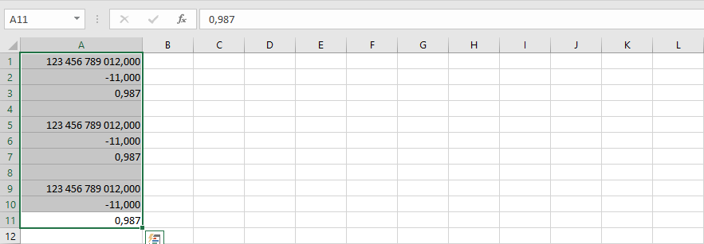
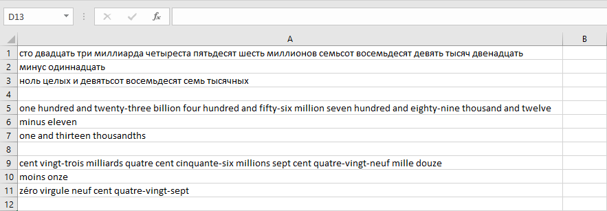

{
  "title": "Преобразовать числа в слова",
  "description": "Преобразование чисел в текстовое представление на разных языках",
  "image": "https://navferty.net/images/Stringify1.png"
}

[Главная](/ru/) › [Команды](/ru/#commands) › Преобразовать числа в слова

# Преобразовать числа в слова

Преобразование чисел в текстовое представление на разных языках:

- Русский
- Английский
- Французский

 

Надстройка бесплатная, с открытым кодом. [Инструкция по установке](/ru/install/).
