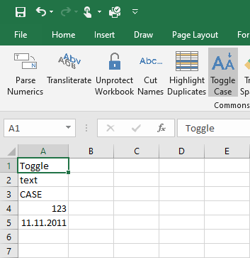
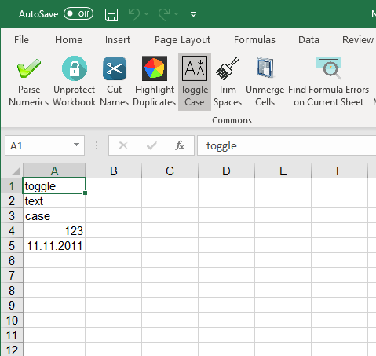
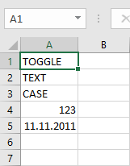
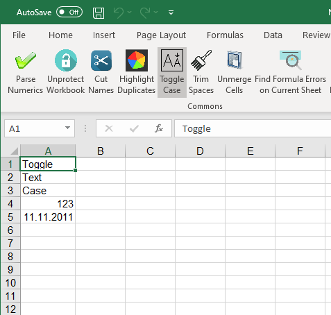

{
  "title": "Изменить регистр",
  "description": "Циклическое переключение регистра текста: Абвгд → абвгд → АБВГД",
  "image": "https://navferty.net/images/ToggleCase1.png"
}

[Главная](/ru/) › [Команды](/ru/#commands) › Изменить регистр

# Изменить регистр

Циклическое переключение регистра текста: `Абвгд` → `абвгд` → `АБВГД`

   

## Как использовать

Выделите текстовые ячейки и нажмите **Регистр**. Регистр всей выборки определяется по первому текстовому значению с буквами: строчные буквы переходят в прописные, прописные — в регистр заголовка, смешанный регистр — в строчный.

Например, последовательные нажатия преобразуют `пример текста` в `ПРИМЕР ТЕКСТА`, затем в `Пример Текста` и обратно в `пример текста`. Одна буква переключается между прописной и строчной.

**Важно:** Ячейки со смешанным регистром не переключаются независимо друг от друга. Команда записывает значения в диапазон и может заменить формулы их результатами; работайте с копией или выделяйте только текст.

Надстройка бесплатная, с открытым кодом. [Инструкция по установке](/ru/install/).
