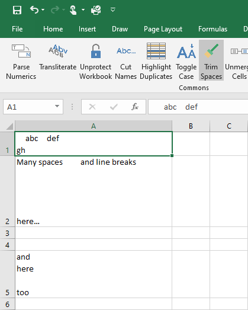
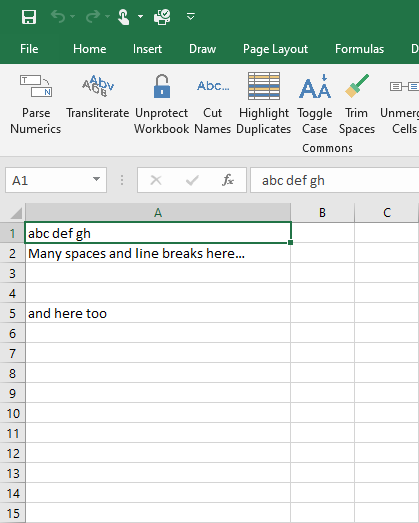

{
  "title": "Удалить пробелы",
  "description": "Удаление лишних пробелов, переносов строк и начальных/конечных пробелов из текстовых ячеек.",
  "image": "https://navferty.net/images/TrimSpaces1.png"
}

[Главная](/ru/) › [Команды](/ru/#commands) › Удалить пробелы

# Удалить пробелы

Удаление лишних пробелов, переносов строк и начальных/конечных пробелов из текстовых ячеек.

 

**Статья по теме:** [Как убрать лишние пробелы в Excel](/ru/articles/remove-extra-spaces-in-excel/)

## Как использовать

Выделите текстовые ячейки и нажмите **Очистить пробелы**. Действие по умолчанию заменяет последовательности пробельных символов, включая переносы строк, одним пробелом и убирает пробелы по краям. Например, `  Новый   год  ` превращается в `Новый год`.

В меню кнопки можно выбрать **Удалить все пробелы**: этот вариант удаляет пробельные символы и между словами, превращая `Новый год` в `Новыйгод`. Ячейки, содержащие только пробельные символы, становятся пустыми. Нетекстовые значения не преобразуются.

**Важно:** Команда записывает значения в выделенный диапазон и может заменить формулы их результатами. Сохраните копию или выделяйте только нужные текстовые ячейки.

Надстройка бесплатная, с открытым кодом. [Инструкция по установке](/ru/install/).
