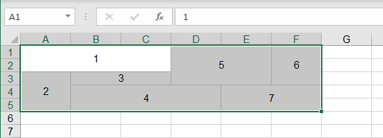
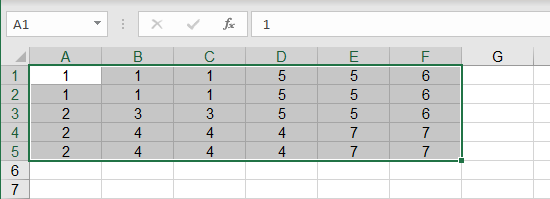

{
  "title": "Разъединить ячейки",
  "description": "Разъединение ячеек с заполнением каждой ячейки исходным объединённым значением.",
  "image": "https://navferty.net/images/Unmerge1.png"
}

[Главная](/ru/) › [Команды](/ru/#commands) › Разъединить ячейки

# Разъединить ячейки

Разъединение ячеек с заполнением каждой ячейки исходным объединённым значением.

 

## Как использовать

Выделите ячейки, включающие объединённые области, и нажмите **Разъединенить**. Например, если объединённый диапазон `A1:A3` содержит `Север`, команда разъединит его и заполнит `A1`, `A2` и `A3` значением `Север`.

Обрабатывается вся объединённая область, даже если выделена только её часть. Формула верхней левой ячейки присваивается каждой ячейке области, поэтому проверьте результаты формул и значения. Перед изменениями сохраните копию.

Надстройка бесплатная, с открытым кодом. [Инструкция по установке](/ru/install/).
