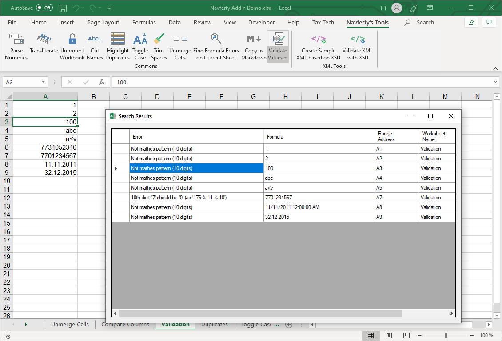

{
  "title": "Валидация значений",
  "description": "Проверка значений ячеек на соответствие определённым форматам",
  "image": "https://navferty.net/images/Validate.png"
}

[Главная](/ru/) › [Команды](/ru/#commands) › Валидация значений

# Валидация значений

Проверка значений ячеек на соответствие определённым форматам:

- [x] Число
- [x] Дата
- [x] ИНН физического лица (12 цифр с контрольными разрядами)
- [x] ИНН юридического лица (10 цифр с контрольным разрядом)
- [x] Текст по символьному фильтру надстройки для XML

*Примечание: Корректный формат ИНН не гарантирует существование организации или физического лица.*

## Как использовать

Выделите ячейки, откройте меню **Проверка** и выберите проверку. В окне результатов показаны некорректные значения, адреса и сообщения; выбор результата выделяет соответствующую ячейку. Пустые ячейки пропускаются, значения не изменяются.

Например, для столбца российских ИНН организаций выберите проверку 10-значного ИНН: значение с неверным контрольным разрядом появится в отчёте. Для ИНН физического лица проверяются 12 цифр и два контрольных разряда. Если важны начальные нули, храните идентификаторы как текст.

**Важно:** Проверка текста для XML — ограничительный символьный фильтр, а не разбор XML или проверка XSD. Она отклоняет, в частности, `<`, `>`, `&`, кавычки и управляющие символы, а также дополнительные диапазоны символов. Для целого XML-файла используйте [проверку XML по XSD](/ru/features/validate-xml/). Правила распознавания чисел и дат могут отличаться от отображения в Excel. Проверка чисел не заменяет [поиск ошибок](/ru/features/find-errors/).

Надстройка бесплатная, с открытым кодом. [Инструкция по установке](/ru/install/).
