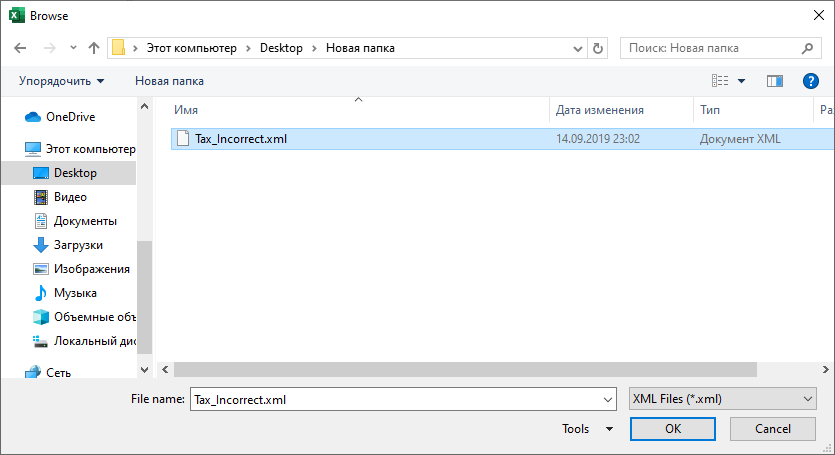

{
  "title": "Валидация XML по XSD",
  "description": "Валидация XML-файла по XSD-схеме. Подробный отчёт об ошибках будет создан в новой книге.",
  "image": "https://navferty.net/images/ValidateXml1.png"
}

[Главная](/ru/) › [Команды](/ru/#commands) › Валидация XML по XSD

# Валидация XML по XSD

Валидация XML-файла по XSD-схеме. Подробный отчёт об ошибках будет создан в новой книге.

## Посмотреть пример отчёта об ошибках

| Серьёзность | Элемент  | Сообщение                                                                                                                         |
|-------------|----------|-----------------------------------------------------------------------------------------------------------------------------------|
| Ошибка      | city     | Элемент 'shipto' содержит недопустимый дочерний элемент 'city'. Ожидаемый список элементов: 'address'.                            |
| Ошибка      | quantity | Элемент 'quantity' недопустим - значение '-5' недопустимо согласно типу данных 'http://www.w3.org/2001/XMLSchema:positiveInteger' |
| Ошибка      | price    | Элемент 'price' недопустим - значение 'asdasd' недопустимо согласно типу данных 'http://www.w3.org/2001/XMLSchema:decimal'        |

**Статья по теме:** [Проверка XML по XSD-схеме в Excel](/ru/articles/validate-xml-against-xsd-in-excel/)

Надстройка бесплатная, с открытым кодом. [Инструкция по установке](/ru/install/).
